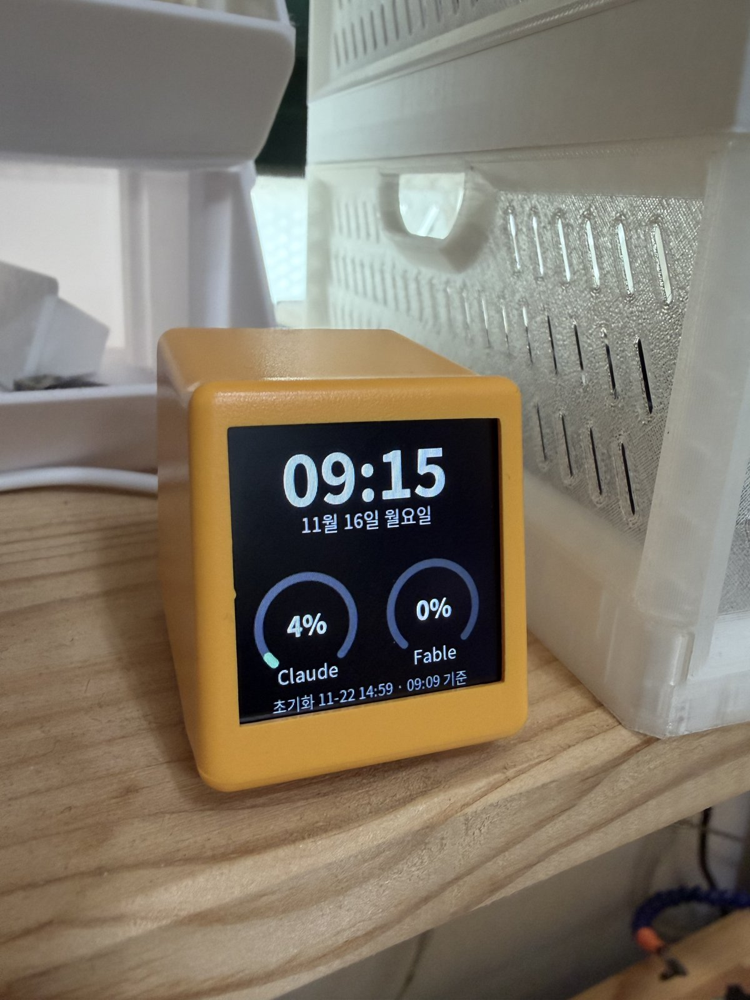
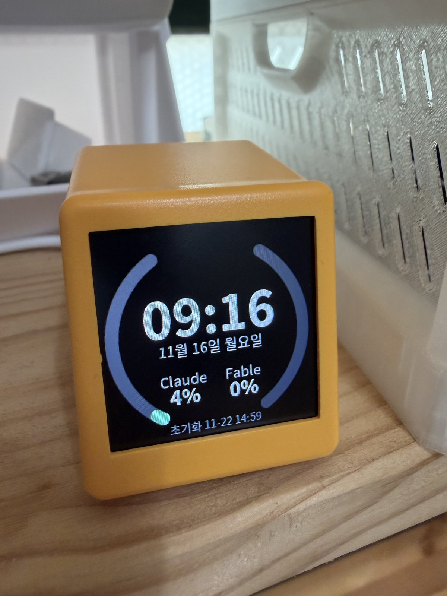

> **This project was built 100% under the direction of Claude.**
> **이 프로젝트는 100% Claude 의 지시하에 만들어졌습니다.**

# Claude Monitoring Tool (클로드 모니터링 도구) — SD Pro Smart Clock Conversion

**[English](#english)** | [한국어](#한국어)

## English

This project wipes the stock firmware of the SD Pro smart clock (ESP8266) and installs our own firmware, which shows the time together with **weekly Claude and Fable usage** (ring gauges, 4 screen designs including a usage-only design, English or Korean display).

- Clock used in this project (SD Pro smart clock): [buy on AliExpress](https://s.click.aliexpress.com/e/_c2IU0b1X)

### In use

| Design B — clock on top, two gauges below | Design C — left and right semicircular rings (default) |
|---|---|
|  |  |

Real device running firmware 0.3.0 with Korean display. The screen design is chosen on the settings page (hardware manual, Section 8.2).

| Folder | Contents | Current version | Manual |
|---|---|---|---|
| [`hardware/`](hardware/) | Clock firmware (PlatformIO · Arduino ESP8266) | **0.4.0** | [English](hardware/README.md) · [한국어](hardware/README.ko.md) |
| [`server/`](server/) | Usage relay server `clock-usage-relay` (Python standard library) + front nginx config | **1.3.0** | [English](server/README.md) · [한국어](server/README.ko.md) |

```
                      HTTPS 443                            HTTP 8787                         HTTPS
┌──────────────────┐                ┌───────────────────┐                ┌────────────────┐            ┌───────────────────┐
│ Clock (hardware) │ ─────────────▶ │ Front nginx proxy │ ─────────────▶ │ relay (server) │ ─────────▶ │ api.anthropic.com │
│ ESP8266          │  Bearer token  │ TLS termination,  │  internal      │ token check,   │  once per  │                   │
│                  │                │ path restriction  │  network only  │ 5-min samples  │  5 min     │                   │
└──────────────────┘                └───────────────────┘                └────────────────┘            └───────────────────┘
```

- The clock calls only one relay endpoint, `GET /clock/usage`. The contract is in Section 2 of the server manual.
- HTTPS is handled by a **separate nginx proxy server that is already in operation**. The relay listens on plain HTTP on the internal network only and accepts connections only from the nginx server IP.
- The Anthropic OAuth token stays on the relay server only. Only usage numbers and the relay token pass through the clock and nginx.

### First-time installation order

1. **Install the relay** — server manual, Section 4 (relay server)
2. **Connect nginx and publish over HTTPS** — server manual, Section 5 (nginx server + relay server firewall)
3. **Flash the clock firmware** — hardware manual, Sections 4–7 (the first flash requires a USB-serial adapter). If the clock already runs our firmware, use Section 9.3 (over-the-air update from 0.3.0 or 0.2.0 to 0.4.0) or Section 9.4 (from 0.1.1 LCD-fix build or 0.1.3)
4. **Enter the URL and token on the clock** — server manual, Section 6

Manuals: hardware [English](hardware/README.md) · [한국어](hardware/README.ko.md), server [English](server/README.md) · [한국어](server/README.ko.md).

### Built files

Binaries are published on GitHub Releases. The repository does not contain binaries.

| Release | Files |
|---|---|
| `hardware-v0.4.0` (latest) | `smartclock-0.4.0-firmware.bin`, `lcd-diag-0.4.0-firmware.bin`, `SHA256SUMS` |
| `hardware-v0.3.0` | `smartclock-0.3.0-firmware.bin`, `lcd-diag-0.3.0-firmware.bin`, `SHA256SUMS` (for rollback) |
| `hardware-v0.2.0` | `smartclock-0.2.0-firmware.bin`, `lcd-diag-0.2.0-firmware.bin`, `SHA256SUMS` (for rollback) |
| `hardware-v0.1.3` | `smartclock-0.1.3-firmware.bin`, `lcd-diag-0.1.3-firmware.bin`, `SHA256SUMS` (for rollback) |
| `server-v1.3.0` | `clock-usage-relay-1.3.0.tar.gz`, `SHA256SUMS` |
| `server-v1.2.0` | `clock-usage-relay-1.2.0.tar.gz`, `SHA256SUMS` (for rollback) |

### Secrets

This repository contains no tokens, credentials, or Wi-Fi passwords. `.gitignore` blocks `credentials.json`, `clock_token`, `.env`-type files, and flash dumps.

---

## 한국어

SD Pro 스마트 클락(ESP8266)의 순정 펌웨어를 지우고 자체 펌웨어를 올려, 시계와 **Claude·Fable 주간 사용률**(원형 게이지, 사용량 전용 디자인을 포함한 화면 디자인 4종, 영어·한국어 표시)을 함께 표시하는 프로젝트입니다.

- 이 프로젝트에 쓴 시계(SD Pro 스마트 클락): [AliExpress 에서 구매](https://s.click.aliexpress.com/e/_c2IU0b1X)

### 실제 사용 모습

| 디자인 B — 위 시계 + 아래 게이지 2개 | 디자인 C — 좌우 반원 링 (기본) |
|---|---|
|  |  |

펌웨어 0.3.0, 한국어 표시로 동작 중인 실기기입니다. 화면 디자인은 설정 페이지에서 고릅니다(`hardware/README.ko.md` 8.2절).

| 폴더 | 내용 | 현재 버전 | 사용 설명서 |
|---|---|---|---|
| [`hardware/`](hardware/) | 시계 펌웨어 (PlatformIO · Arduino ESP8266) | **0.4.0** | [한국어](hardware/README.ko.md) · [English](hardware/README.md) |
| [`server/`](server/) | 사용량 중계 서버 `clock-usage-relay` (Python 표준 라이브러리) + 앞단 nginx 설정 | **1.3.0** | [한국어](server/README.ko.md) · [English](server/README.md) |

```
┌──────────────┐  HTTPS 443   ┌───────────────────┐  HTTP 8787   ┌──────────────┐  HTTPS   ┌───────────────────┐
│ 시계 (hardware)│ ───────────▶ │ 앞단 nginx 프록시 서버 │ ───────────▶ │ relay (server) │ ───────▶ │ api.anthropic.com │
│ ESP8266       │  Bearer 토큰  │ TLS 종료·경로 제한   │  내부망 전용   │ 토큰 확인·표본   │  5분 1회  │                   │
└──────────────┘              └───────────────────┘              └──────────────┘          └───────────────────┘
```

- 시계는 relay 의 `GET /clock/usage` 하나만 호출합니다. 계약은 `server/README.ko.md` 2장입니다.
- HTTPS 는 **기존에 운영 중인 별도 nginx 프록시 서버**가 처리합니다. relay 는 내부망에서 평문 HTTP 로만 열리고, nginx 서버 IP 에서만 접속을 받습니다.
- Anthropic OAuth 토큰은 relay 서버 안에만 있습니다. 시계와 nginx 에는 사용률 숫자와 relay 토큰만 지나갑니다.

### 처음 설치 순서

1. **relay 설치** — `server/README.ko.md` 4장 (relay 서버)
2. **nginx 연결·HTTPS 공개** — `server/README.ko.md` 5장 (nginx 서버 + relay 서버 방화벽)
3. **시계 펌웨어 기록** — `hardware/README.ko.md` 4~7장 (처음 한 번은 USB-시리얼 어댑터로 기록), 이미 우리 펌웨어가 있으면 9.3절(0.3.0 · 0.2.0 에서 무선 업데이트로 0.4.0) 또는 9.4절(0.1.1 LCD 수정판·0.1.3 에서)
4. **시계에 URL·토큰 입력** — `server/README.ko.md` 6장

### 빌드된 파일

GitHub Releases 에 올립니다. 저장소에는 바이너리를 넣지 않습니다.

| 릴리스 | 파일 |
|---|---|
| `hardware-v0.4.0` (최신) | `smartclock-0.4.0-firmware.bin`, `lcd-diag-0.4.0-firmware.bin`, `SHA256SUMS` |
| `hardware-v0.3.0` | `smartclock-0.3.0-firmware.bin`, `lcd-diag-0.3.0-firmware.bin`, `SHA256SUMS` (되돌리기용) |
| `hardware-v0.2.0` | `smartclock-0.2.0-firmware.bin`, `lcd-diag-0.2.0-firmware.bin`, `SHA256SUMS` (되돌리기용) |
| `hardware-v0.1.3` | `smartclock-0.1.3-firmware.bin`, `lcd-diag-0.1.3-firmware.bin`, `SHA256SUMS` (되돌리기용) |
| `server-v1.3.0` | `clock-usage-relay-1.3.0.tar.gz`, `SHA256SUMS` |
| `server-v1.2.0` | `clock-usage-relay-1.2.0.tar.gz`, `SHA256SUMS` (되돌리기용) |

### 비밀값

이 저장소에는 토큰·자격증명·Wi-Fi 비밀번호를 넣지 않습니다. `.gitignore` 가 `credentials.json`, `clock_token`, `.env` 류와 flash 덤프를 막습니다.
