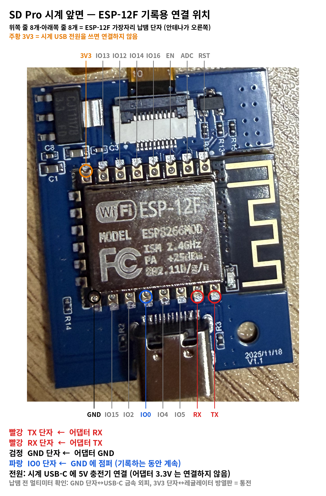
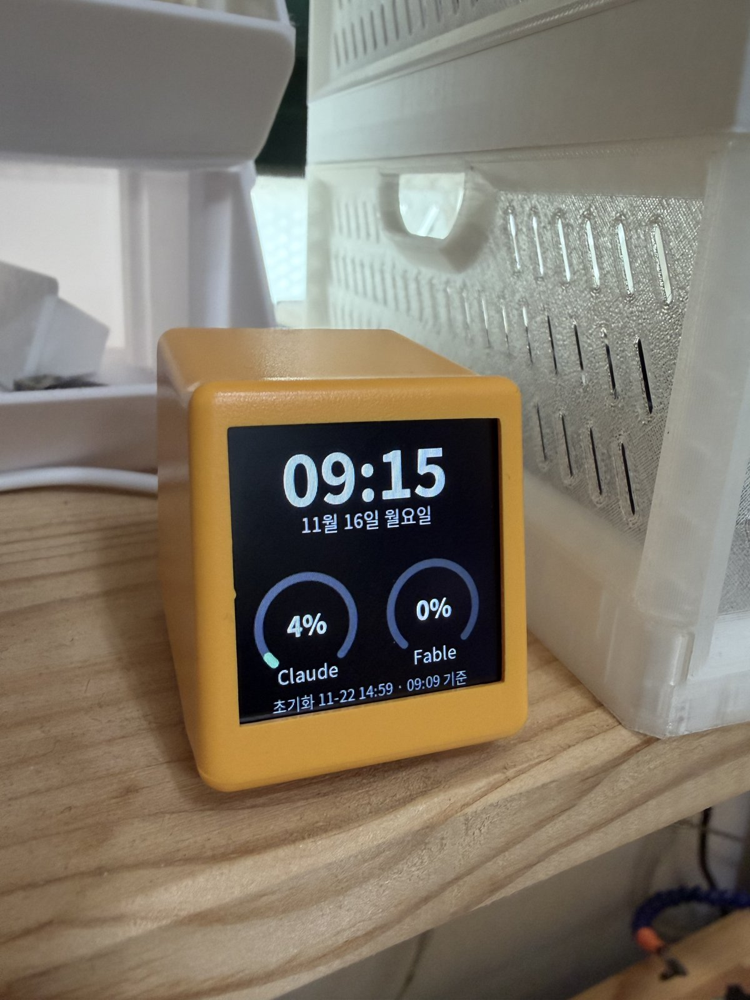
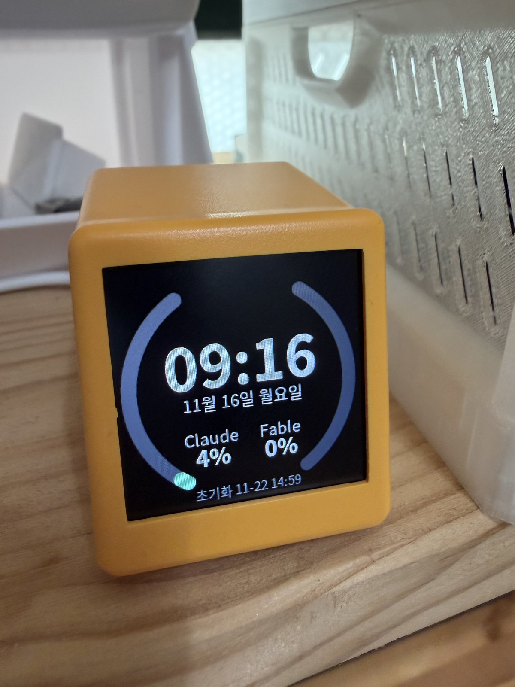
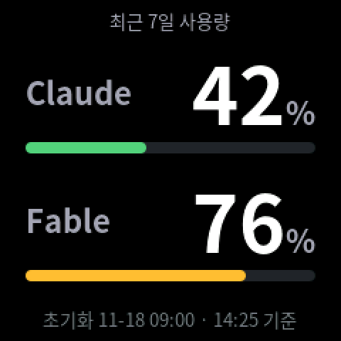
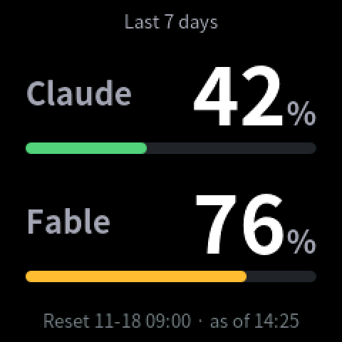
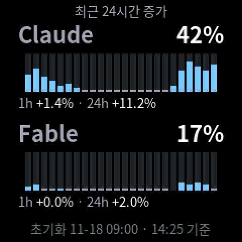
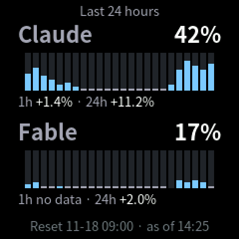

[English](README.md) | **한국어**

# SmartClock 펌웨어 (hardware) — 0.5.0

SD Pro 스마트 클락(ESP-12F / ESP8266, 4MB flash, ST7789 240×240 LCD)에 올리는 자체 펌웨어입니다. 처음부터 새로 작성했고 순정 펌웨어의 코드·폰트·이미지는 쓰지 않습니다.

- 화면: 시각(`HH:MM`)·날짜(한국어 `11월 15일 일요일`, 영어 `Sun, Nov 15`)와 Claude·Fable 주간 사용률 원형 게이지 2개 (NTP, 기본 시간대 `KST-9`). 디자인 D·E 는 시각·날짜 없이 사용량만 표시
- 표시 언어: 영어·한국어 중 선택(기본 한국어). 설정 웹페이지와 시계 화면에 함께 적용되고, 설정 항목마다 짧은 설명이 붙습니다(8.3절)
- 화면 디자인 5종(A 동심원 링 / B 위 시계 + 아래 게이지 / C 좌우 반원 링 / D 사용량 전용 큰 숫자 + 가로 막대 / E 사용량 전용 최근 24시간 시간별 증가 막대그래프, 기본 C). 하나로 고정하거나 자동 순환합니다(8.2절)
- 사용량: 중계 서버 `server/` 가 주는 JSON 을 받아 그림
- 무선 업데이트(OTA): 웹 업로드 `/update`(Digest 인증 + CSRF 토큰) + ArduinoOTA(비밀번호 필수)
- 설정 웹페이지: 언어, 사용량 URL·토큰, HTTPS 인증서 검증 방식, 시간대, 밝기, 화면 디자인, 관리자 비밀번호, Wi-Fi 재설정, 공장 초기화
- HTTPS 인증서 검증: 기본은 내장 루트 인증서(ISRG Root X1·X2 = Let's Encrypt) 검증

중계 서버 설치·외부 공개(nginx)는 [`../server/README.ko.md`](../server/README.ko.md) 에 있습니다.

## 0. 버전

> **CAUTION** — 0.1.1 은 서로 다른 두 빌드가 같은 버전 문자열을 씁니다. 0.1.2 에는 LCD 정렬 수정이 빠져 있어 **실기기에서 부팅 직후 `Exception (9)` 로 재시작을 반복합니다**(0.1.0 실기기 로그로 확인, 0.1.2 는 같은 코드). 0.1.2 는 쓰지 말고 0.5.0(또는 0.1.3)을 쓰십시오. 0.4.0 · 0.3.0 · 0.2.0 에서 0.5.0 으로 올리는 절차는 9.3절, 0.1.3 · 0.1.1(LCD 수정판)에서 올리는 절차는 9.4절에 있습니다.

> **NOTE** — 0.5.0 과 0.4.0 은 실기기 확인 전입니다. 0.3.0 은 디자인 B·C 한국어 화면만 실기기로 확인했습니다. 1장 표의 `UNVERIFIED`(미확인) 항목은 시계에 올린 뒤 확인합니다.

## 1. 검증 상태

| 항목 | 상태 |
|---|---|
| `pio run -e smartclock` 빌드 (0.5.0) | `CONFIRMED` — RAM 42.1% (34,460 B), Flash 61.0% (636,735 B), `firmware.bin` 640,880 B. 0.4.0 대비 RAM +580 B, Flash +5,060 B, `firmware.bin` +5,056 B |
| `pio run -e lcd-diag` 빌드 (0.5.0) | `CONFIRMED` — RAM 35.0% (28,640 B), Flash 31.6% (329,595 B), `firmware.bin` 333,744 B (0.4.0 대비 +1,760 B, 한글 글자 5개 추가분) |
| PC 시험 (`test/pc/run.sh`) | `CONFIRMED` — 22개 묶음 451개 검사 통과(0.4.0 은 17개 묶음 353개). JSON 해석, 두 언어의 상태 문구, 두 언어의 화면 배치 폭(디자인 D 바닥글 전부가 224 px 칸에 들어감, 디자인 E 문구 폭 포함), 설정 저장·이전(디자인·언어 키), 검증 방식·토큰 경고 판정. 0.5.0 추가분: 증가량 해석(값, `null`, 없음 = 1.2.0 relay, 숫자 아님), 두 언어의 증가량 문구, `hourly`(24개, `null`, 짧음, 김, 배열 아님), `?hourly=1` 일 때 4,096 바이트 본문 한도, `hourly` 를 요청하는 조건 |
| 화면 5종 렌더링·부분 갱신 (`test/pc/sim/run.sh`) | `CONFIRMED`(PC) — 실제 `lcd.cpp`·`ui.cpp` 가 보내는 SPI 바이트를 가짜 ST7789 로 받아 그림. 2개 언어 × 5종 × 10상태 = 100장 + 디자인 D 시안 8장 + 디자인 E 시안 7장 + 설정 모드·메시지 화면 6장에서 글자 상자와 링·막대·그래프 픽셀 겹침 0, 칸보다 넓은 글자 0 px. 디자인 E 7장(정상, 증가량 `null`, 초기화 직후, 서버 오류, 1.2.0 relay, 90% 이상, 영어)은 보드가 승인한 SOO-658 시안과 픽셀 단위로 같음(다른 픽셀 0), A~D 화면은 0.4.0 과 픽셀 단위로 같음(94개 중 94개). 같은 분 안 590프레임 전송 0 px, 분 변경 시 시각 상자 6,450 px 만(A~C) 또는 0 px(D·E), 디자인 D 값 변경 시 그 숫자와 막대만(5,975 px), 디자인 E 는 사용률이 바뀌면 그 숫자만(Claude 42→47: 1,700 px), 증가량이 바뀌면 그 줄만(204 × 16 = 3,264 px), 그래프는 값이나 공통 눈금이 바뀔 때만. 값 / `표본 부족` / 오류 / 1.2.0 / 짧은 `hourly` 를 거치는 부분 갱신 결과가 새로 그린 화면과 픽셀 단위로 같음(차이 0 px), 디자인·언어 전환 시 1회 전체(디자인 E 첫 화면 91,040 px) |
| 웹페이지 (`test/pc/web/run.sh`) | `CONFIRMED`(PC) — 실제 `web_pages.cpp` 로 관리 페이지·설정 포털·업데이트 페이지·안내 페이지를 두 언어로 HTML 파일에 씀. 모든 문구가 두 언어에 있음, 입력값 HTML 이스케이프, 가장 큰 조각 1.1 KB 미만, 디자인 A~E 가 목록에 있고 E 를 고를 수 있음 |
| 자동 순환 타이밍 (`include/layout_cycle.h`) | `CONFIRMED`(PC) — 순서 A→B→C→D→E, 간격, 저장 시 처음부터, `millis()` 32비트 넘김 |
| 설정 이전 (0.1.x · 0.2.0 · 0.3.0 · 0.4.0 → 0.5.0) | `CONFIRMED`(PC) — 0.4.0 형식 `settings.json`(디자인 `A`~`D`)은 그대로 읽히고, `E` 도 올바른 값. 0.2.0 파일은 기존 값 유지 + 언어 한국어(`ko`). `lang` 이 없거나 잘못된 값이면 한국어, `layout` 이 잘못된 값이면 `C`. 0.1.x 파일은 디자인 기본값(`C`·`fixed`·15초)도 붙음 |
| LCD 핀 기본값 (3장) | `CONFIRMED` — 2026-11-14 보드 실기기(LCD 수정판 0.1.1)에서 화면 표시 |
| 시리얼 기록 절차 (CP2102, macOS) | `CONFIRMED` — 2026-11-14 보드가 같은 절차로 기록 |
| 내장 루트 인증서 | `CONFIRMED` — `tools/gen_ca_roots.py` 가 SHA-256 지문을 고정값과 대조. ISRG Root X1 `96bcec06…bddf08c6`, X2 `69729b8e…3ccb1470` |
| 0.3.0 실기기 화면, 디자인 B·C 한국어 | `CONFIRMED` — 8.2절 사진 (2026-11-16) |
| 0.2.0·0.3.0 실기기 화면: 디자인 A, 영어 문구, 원호 그리기 시간 | `UNVERIFIED` — 실기기 필요. 디자인 전환 1회에 링 픽셀 약 2만~3만 개를 부동소수점으로 계산합니다 |
| 0.4.0 실기기 화면: 디자인 D (배치, 막대 그리기, 색) | `UNVERIFIED` — 실기기 필요. PC 에서 SOO-655 시안과만 대조했습니다(8.2절) |
| 0.5.0 실기기 화면: 디자인 E (배치, 막대, 색) | `UNVERIFIED` — 실기기 필요. PC 에서 SOO-658 시안과만 대조했습니다(8.2절) |
| 0.5.0 이 relay 1.3.0 서버에서 `?hourly=1` 로 실제 조회, 그 뒤 남은 힙 | `UNVERIFIED` — 실기기 필요. PC 추정: `?hourly=1` 응답을 해석하는 동안 힙이 약 1.0–1.4 KB 더 듭니다(시간별 숫자 48개용 ArduinoJson 1 KB 슬롯 묶음 하나 + 응답 본문 약 0.2–0.4 KB 증가). 해석이 끝나면 돌려줍니다. 고정 RAM 사용량은 0.4.0 보다 580 B 많습니다. `/api/status` 의 힙 값으로 확인합니다 |
| 실기기에서 웹페이지 조각 전송 | `UNVERIFIED` — 실기기 필요. PC 에서만 확인했습니다(8.3절) |
| Wi-Fi 설정 포털, NTP, 사용량 조회, OTA 2종 | `UNVERIFIED` — 실기기 확인 결과가 아직 없습니다 |
| CA 검증으로 실제 Let's Encrypt 서버(nginx) 접속 | `UNVERIFIED` — 실제 도메인 필요 |
| HTTPS 접속 중 힙 여유 | `UNVERIFIED` — `/api/status` 의 `tls` 값으로 확인합니다(8.1절) |

## 2. 빠른 시작

| 하려는 일 | 읽을 곳 |
|---|---|
| 순정 시계에 처음 기록 | 4장 → 5장 → 6장 → 7장 |
| 0.4.0 · 0.3.0 · 0.2.0 시계를 0.5.0 으로 | 9.3절 |
| 0.1.3 · 0.1.1 시계를 0.5.0 으로 | 9.4절 |
| 화면 디자인 바꾸기·자동 순환 | 8.2절 |
| 언어를 영어·한국어로 바꾸기 | 8.3절 |
| 사용량 표시 연결 | `server/README.ko.md` 6장(시계 설정) |
| 화면이 안 나옴 | 3.1절 |
| 소스에서 직접 빌드 | 2.1절 |

빌드된 파일은 GitHub Releases 의 `hardware-v0.5.0` 에 있습니다. 이전 판은 `hardware-v0.3.0`·`hardware-v0.2.0`·`hardware-v0.1.3` 에 남아 있습니다. 0.4.0 은 Release 로 공개하지 않았습니다. 필요하면 커밋 `2b5a7b7` 을 직접 빌드합니다(2.1절).

| 파일 | 용도 |
|---|---|
| `smartclock-0.5.0-firmware.bin` | 본 펌웨어 |
| `lcd-diag-0.5.0-firmware.bin` | 화면 핀 진단 (Wi-Fi 없음) |
| `SHA256SUMS` | 파일 확인용 |

```bash
sha256sum -c --ignore-missing SHA256SUMS      # macOS: shasum -a 256 -c --ignore-missing SHA256SUMS
```

### 2.1 소스에서 빌드

```bash
cd hardware
python3 -m pip install platformio "esptool>=5"
pio run -e smartclock             # → .pio/build/smartclock/firmware.bin
pio run -e lcd-diag               # → .pio/build/lcd-diag/firmware.bin
test/pc/run.sh                    # PC 시험. g++ 필요. smartclock 을 한 번 빌드한 뒤 실행
test/pc/sim/run.sh out/           # 화면 5종 × 두 언어 PC 렌더 + 부분 갱신 검사 → out/*.ppm
python3 test/pc/sim/make_sheet.py out/ png/   # ppm → png 와 비교표 (Pillow 필요)
test/pc/web/run.sh web/           # 웹페이지 전체를 두 언어로 PC 렌더 → web/*.html
python3 tools/gen_fonts.py        # 화면 글자를 바꿀 때만 (결과 src/fonts_gen.cpp 는 이미 들어 있음)
python3 tools/gen_ca_roots.py     # 루트 인증서를 바꿀 때만 (결과 src/ca_roots_gen.cpp 는 이미 들어 있음)
```

- 플랫폼 `espressif8266@4.2.1` (Arduino 코어 3.1.2), 보드 `esp12e`, flash 4MB **DOUT 모드**, CPU 160MHz.
- flash 분할 `eagle.flash.4m1m.ld`: 펌웨어 약 1MB, OTA 임시 영역 약 2MB, LittleFS 1MB(`0x300000`–`0x3FA000`).
- 외부 라이브러리는 ArduinoJson 7.4.2 하나입니다.
- 화면 글꼴은 Noto Sans CJK KR(SIL OFL 1.1)에서 필요한 글자만 뽑았습니다. ASCII + `tools/glyphs_ko.txt` 의 한글만 있고, 없는 글자는 `?` 로 나옵니다.
- 첫 빌드는 툴체인을 받느라 수 분이 걸립니다.

## 3. LCD 핀 설정

모든 핀·패널 옵션은 `platformio.ini` 의 `[lcd] build_flags` **한 줄**에 있습니다. 값을 바꾸고 다시 빌드합니다.

| 플래그 | 기본값 | 뜻 |
|---|---|---|
| `LCD_MOSI` / `LCD_SCLK` | 13 / 14 | SPI 데이터·클럭. 13/14 이면 하드웨어 SPI, 그 외 값이면 소프트웨어 SPI(느림) |
| `LCD_CS` | -1 | 칩 선택. -1 = 사용 안 함 |
| `LCD_DC` | 0 | 데이터/명령 선택 |
| `LCD_RST` | 2 | 리셋. -1 = 사용 안 함 |
| `LCD_BL` | 5 | 백라이트 |
| `LCD_BL_ACTIVE_LOW` | 1 | 1 = LOW 일 때 켜짐 |
| `LCD_SPI_MODE` | 3 | CS 없는 ST7789 는 보통 3 |
| `LCD_INVERT` | 1 | IPS 패널 색 반전 |
| `LCD_BGR` | 0 | 빨강·파랑이 바뀌어 보이면 1 |
| `LCD_ROTATION` | 0 | 0–3 (90° 단위) |

기본값은 2026-11-14 보드 실기기에서 화면이 나온 값입니다. 다른 계열 기기에 쓸 때만 3.1절로 핀을 찾습니다.

### 3.1 화면이 안 나올 때 — 핀 진단 빌드 (`lcd-diag`)

1. `lcd-diag-0.5.0-firmware.bin` 을 6장 절차로 기록합니다.
2. 진단 펌웨어는 핀 후보 16조합 × SPI 모드 2 × 백라이트 극성 2 = **64단계**를 4초씩 돌립니다(한 바퀴 약 4분 16초).
3. 화면이 보이는 단계의 큰 숫자와 아래 두 줄(`DC0 RST2 CS-1 BL5`, `MODE3 BL-LOW RED`)을 적습니다. 시리얼(115200bps)에도 같은 내용이 찍힙니다.
4. 배경색이 글자(`RED`/`GREEN`/`BLUE`)와 다르면 `LCD_BGR` 을 반대로 바꿉니다.
5. 적은 값을 `[lcd] build_flags` 에 넣고 `smartclock` 을 다시 빌드합니다.
6. 64단계 모두 안 보이면 화면 케이블(FPC)이 꽂히는 기판 쪽 커넥터와 주변 배선 사진(앞·뒤)을 찍어 태스크에 남겨 주십시오.

시리얼 로그 보기:
```bash
python3 -m serial.tools.miniterm <포트> 115200 --dtr 0 --rts 0
```
부팅 직후 깨진 글자 한 줄은 정상입니다(ESP8266 부트롬이 74880bps 로 찍는 문구).

## 4. 준비물과 배선

### 4.1 USB-시리얼 어댑터

| 제품 | 판정 |
|---|---|
| **CP2102** | 권장. 신호선이 항상 3.3V 라 점퍼 위치와 관계없이 안전합니다(VCC 를 연결하지 않을 때) |
| CH340G | 사용 가능. 점퍼 하나로 신호 전압이 함께 바뀌므로 **3.3V 에 둡니다** |
| USBasp(HW-437) | **사용 불가.** AVR 전용 ISP 기록기이고 시리얼 포트가 생기지 않습니다 |

> **WARNING** — ESP8266 단자는 3.3V 용(최대 3.6V)입니다. 5V 신호가 RX 단자에 들어가면 칩이 손상될 수 있습니다. 연결 전에 어댑터만 PC 에 꽂고 멀티미터로 **TX ↔ GND** 를 재십시오. 3.0–3.4V 이면 연결합니다. 4.5V 이상이면 점퍼를 바꾸고 다시 잽니다.

### 4.2 배선

| 어댑터 | ESP-12F 패드 |
|---|---|
| TX | RXD (GPIO3) |
| RX | TXD (GPIO1) |
| GND | GND |
| VCC | **연결하지 않습니다.** 전원은 시계 USB-C 로 넣습니다 |
| — | **GPIO0 → GND** 점퍼: 다운로드 모드 진입용. 지우기~검증 내내 붙여 둡니다 |

- 어댑터와 시계의 GND 를 반드시 공통으로 묶습니다.
- GPIO0 을 GND 에 붙인 채 전원을 넣으면 다운로드 모드로 켜집니다. 이 상태에서는 어떤 펌웨어도 실행되지 않습니다.
- 시계 기판의 연결 위치(앞면, USB-C 가 아래쪽): 빨강 = 어댑터 RX/TX, 검정 = GND, 파랑 = IO0(GPIO0)→GND 점퍼, 주황 = 3V3(시계 USB-C 로 전원을 넣으면 연결하지 않음).



| 사진의 단자 | 위치 (아래쪽 줄, USB-C 가 아래쪽) | 연결 대상 |
|---|---|---|
| TX | 맨 오른쪽 | 어댑터 RX |
| RX | 오른쪽 2번째 | 어댑터 TX |
| GND | 맨 왼쪽 | 어댑터 GND |
| IO0 | 왼쪽 4번째 | GND 에 점퍼 (기록하는 동안 계속 연결) |

- 납땜 전에 멀티미터로 통전을 확인합니다: GND 단자 ↔ USB-C 금속 외피, 3V3 단자(위쪽 줄 맨 왼쪽) ↔ 레귤레이터 방열판. 하나라도 통전되지 않으면 납땜하지 않습니다.

## 5. 기록 프로그램 설치 (esptool)

1. Python 3 를 설치합니다(없을 때만). Windows 는 설치 화면에서 "Add python.exe to PATH" 를 체크합니다.
2. esptool 과 시리얼 모니터를 설치합니다.
   ```bash
   python3 -m pip install "esptool>=5" pyserial
   ```
3. Windows 에서 포트가 보이지 않으면 Silicon Labs "CP210x VCP Driver" 를 설치합니다. macOS·Linux 는 대부분 드라이버가 필요 없습니다.
4. 어댑터를 꽂고 포트 이름을 확인합니다.

| OS | 확인 방법 | 예 |
|---|---|---|
| Windows | 장치 관리자 → 포트(COM & LPT) | `COM3` |
| macOS | `ls /dev/cu.*` | `/dev/cu.usbserial-0001`, `/dev/cu.SLAB_USBtoUART` |
| Linux | `ls /dev/ttyUSB*` | `/dev/ttyUSB0` (권한 오류 시 `sudo usermod -aG dialout $USER` 후 재로그인) |

5. 연결을 확인합니다. GPIO0 을 GND 에 둔 채 시계 USB-C 전원을 뺐다 꽂고 실행합니다.
   ```bash
   esptool --chip esp8266 --port <포트> --after no-reset chip-id
   ```
   `Chip is ESP8266EX` 가 나오면 연결이 맞습니다.

- esptool 4.x 는 명령의 `-` 를 `_` 로 바꿉니다(`erase_flash`, `write_flash`, `read_flash`, `--after no_reset`, `--flash_mode`, `--flash_size`).
- `Failed to connect` 가 나오면 ① TX·RX 를 서로 바꿔 꽂고 ② GPIO0 이 GND 에 붙은 상태로 전원을 다시 넣은 뒤 재시도합니다.

## 6. 완전 삭제 + 기록 + 검증

> **WARNING** — `erase-flash` 는 4MB 전체(순정 펌웨어, 저장된 Wi-Fi, 제조사 활성화 상태 포함)를 되돌릴 수 없게 지웁니다. 순정 펌웨어 백업은 하지 않기로 보드가 결정했습니다(2026-11-13).

> **CAUTION** — 순정 펌웨어의 웹 OTA(`/update_ota`)로 이 펌웨어를 올리지 않습니다. 순정 영역이 지워지지 않습니다. 처음 한 번은 반드시 시리얼로 지우고 기록합니다.

### 6.1 자동 (권장)

```bash
cd hardware
tools/clean_flash.sh <포트> smartclock-0.5.0-firmware.bin
```

- 칩 확인 → 전체 삭제 → `0x0` 에 기록 → 4MB 읽기 → 검증을 차례로 합니다. 단계마다 "GPIO0 을 GND 에 둔 채 전원을 뺐다 꽂고 Enter" 를 요청합니다.
- 어댑터에 자동 리셋 회로(DTR/RTS)가 있으면 앞에 `AUTO_RESET=1` 을 붙입니다.
- 기본 속도는 115200bps 입니다(4MB 읽기 약 6분). 배선이 안정적이면 `BAUD=460800` 을 붙입니다.

### 6.2 수동

```bash
# GPIO0 을 GND 에 붙이고 전원 투입. 각 명령 사이에 전원을 뺐다 꽂습니다(GPIO0 은 계속 GND).
esptool --chip esp8266 --port <포트> --after no-reset chip-id
esptool --chip esp8266 --port <포트> --after no-reset erase-flash
esptool --chip esp8266 --port <포트> --after no-reset write-flash --flash-mode keep --flash-size keep 0x0 smartclock-0.5.0-firmware.bin
esptool --chip esp8266 --port <포트> --after no-reset read-flash 0x0 0x400000 dump.bin
python3 tools/verify_flash.py dump.bin smartclock-0.5.0-firmware.bin
```

- LittleFS 이미지는 기록하지 않습니다. 펌웨어가 첫 부팅 때 스스로 만듭니다.

### 6.3 검증 기준 (`tools/verify_flash.py`)

1. 덤프가 정확히 4MB 인지 확인합니다.
2. `0x0` 부터 펌웨어 길이만큼이 파일과 같은지 확인합니다. 헤더 2·3번째 바이트(flash 모드·크기) 차이는 `NOTE` 로만 보고합니다.
3. 나머지 영역이 4KB 섹터 단위로 전부 `0xFF` 인지 확인합니다.
4. 순정 펌웨어 문자열(`SD Pro`, `SDPro`, `Smart weather clock`, `update_ota`, `weatherkey`, `indexwifi.html`, `photo-setting.html`, `Device Key`, `Filename must start with`)이 하나라도 있으면 실패입니다.
5. 결과는 `RESULT: PASS` / `RESULT: FAIL`, 종료 코드 0 / 1 입니다.

- 이미 부팅한 뒤 덤프했다면 `--post-boot` 를 붙입니다. 펌웨어가 쓰는 영역(LittleFS, EEPROM `0x3FB000`, RF 보정 `0x3FC000`, Wi-Fi 설정 `0x3FD000`–`0x400000`)만 허용합니다.

## 7. 첫 부팅과 Wi-Fi 설정

1. GPIO0 점퍼를 떼고 전원을 다시 넣습니다.
2. 저장된 Wi-Fi 가 없으면 **설정 모드**(영어 `Setup mode`) 화면이 나옵니다. 새 시계는 한국어로 나옵니다.
   - AP 이름 `SmartClock-XXXX`(칩 ID 끝 4자리)와 AP 비밀번호(기기마다 무작위 8자)
   - 접속 주소 `http://192.168.4.1`
   - 관리자 계정 `admin / <무작위 10자>` — **이 값을 적어 둡니다.** 설정 페이지와 OTA 비밀번호입니다.
3. 휴대폰·PC 로 그 AP 에 접속하면 설정 페이지가 뜹니다(안 뜨면 `http://192.168.4.1`).
4. 맨 위에서 언어(`English` / `한국어`)를 고르고, 네트워크를 고르고 Wi-Fi 비밀번호를 넣습니다. 관리자 비밀번호를 바꾸려면 8자 이상으로 입력합니다(비우면 화면의 값 유지). 언어를 바꾸면 저장할 때 시계의 설정 모드 화면도 그 언어로 바뀝니다.
5. 저장하면 재시작해 그 네트워크에 접속합니다. 화면에 IP 주소와 호스트 이름(`smartclock-xxxx`)이 3초간 나옵니다.

- 저장된 Wi-Fi 에 30초 안에 붙지 못하면 설정 모드를 5분간 열었다가 재시작해 다시 시도합니다.
- 어떤 HTTP 응답에도 Wi-Fi 비밀번호·사용량 토큰·관리자 비밀번호를 돌려주지 않습니다.
- ESP8266 은 **2.4GHz Wi-Fi 만** 지원합니다.

## 8. 설정 웹페이지

- 주소: `http://<시계 IP>/` 또는 `http://smartclock-xxxx.local/`
- 인증: HTTP Digest, 사용자 `admin`. 연속 10회 실패하면 60초간 잠깁니다.
- 모든 변경은 POST + 부팅마다 바뀌는 CSRF 토큰이 있어야 처리합니다.

항목 이름은 한국어 화면 기준이고, 괄호 안은 영어 화면의 이름입니다.

| 항목 | 설명 |
|---|---|
| Language / 언어 | `English` / `한국어`. 설정 페이지와 시계 화면의 언어. 8.3절 |
| JSON 주소 (JSON URL) | 사용량 JSON 주소. 회사 밖에서 쓰면 `https://<도메인>/clock/usage` |
| Bearer 토큰 (Bearer token) | 중계 서버 토큰. 비우면 기존 값 유지, "토큰 지우기"(clear token) 체크로 삭제. 다시 표시되지 않습니다 |
| HTTPS 인증서 검사 (HTTPS certificate check) | `CA`(기본) / `SHA-1 지문 고정` / `검사 안 함`. 8.1절 |
| TLS SHA-1 지문 (TLS SHA-1 fingerprint) | 지문(fingerprint) 방식일 때만. 40자리 hex(`:` 허용) |
| 갱신 간격 (Refresh interval) | 조회 주기(분), 기본 10. 실패하면 2분 간격 재시도 |
| POSIX 시간대 (POSIX time zone) | 기본 `KST-9`. 예: `UTC0`, `EST5EDT,M3.2.0,M11.1.0` |
| 밝기 (Brightness) | 0–100 (0 = 백라이트 끔) |
| 화면 디자인 / 디자인 전환 / 순환 간격 (Screen design / Design change / Cycle interval) | 화면 디자인·자동 순환(0.2.0, 디자인 D 는 0.4.0, 디자인 E 는 0.5.0). 8.2절 |
| 관리자 비밀번호 (Admin password) | 8자 이상. 바꾸면 OTA 비밀번호도 함께 바뀝니다 |
| 재시작 / Wi-Fi 정보 지우기 / 공장 초기화 (Reboot / Forget Wi-Fi / Factory reset) | 재시작 / Wi-Fi 만 삭제 / Wi-Fi + 모든 설정 삭제 |

- 각 항목 이름 아래에 고른 언어로 짧은 설명이 붙습니다.
- `GET /api/status` (인증 필요): 버전, IP, RSSI, 남은 힙, 시각, 사용량 조회 상태, `relay_status`, `tls_mode`, `waiting_for_time`, `lang`, `tls` 메모리 수치.

> **CAUTION** — 기기 웹페이지는 HTTP 입니다. 비밀번호 자체는 Digest 로 보호되지만 설정 내용은 같은 네트워크에서 볼 수 있습니다. 신뢰하는 내부망에서만 씁니다.

### 8.1 HTTPS 인증서 검증 방식

| 방식 | 동작 | 쓰는 경우 |
|---|---|---|
| `CA` (기본) | 서버 인증서 체인이 내장 루트 **ISRG Root X1 또는 X2** 로 이어지는지, 유효 기간 안인지 검사 | 앞단 nginx 가 **Let's Encrypt** 인증서를 쓸 때. 인증서가 갱신돼도 설정을 바꿀 필요가 없습니다 |
| `fingerprint` | 서버 인증서 SHA-1 지문만 비교 | Let's Encrypt 가 아닌 인증서(사내 CA, 자체 서명, 다른 인증기관). **인증서가 갱신되면 지문이 바뀌어 끊깁니다** |
| `insecure` | 검사 안 함 | 시험용만 |

- **CA 방식은 시각이 맞아야 합니다.** NTP 시각을 받기 전에는 조회를 미루고 `시각 동기화 대기`(영어 `Waiting for time`)를 표시합니다.
- nginx 는 `ssl_certificate` 에 **`fullchain.pem`** 을 지정해야 합니다. `cert.pem` 만 주면 중간 인증서가 빠져 CA 검증이 실패합니다(`server/README.ko.md` 5.4절).
- 토큰이 설정된 상태에서 `https://` + `insecure` 이면 `인증서 검증 안 함`(영어 `No cert check`), `http://` 이면 `토큰 평문 전송`(영어 `Plaintext token`) 경고가 화면에 주황색으로 나옵니다.
- 메모리: nginx 는 TLS Max Fragment Length 를 지원하지 않으므로 수신 16KB·송신 512B 버퍼로 접속합니다. `/api/status` 의 `tls` 값으로 여유를 봅니다.

| 필드 | 뜻 |
|---|---|
| `heap_before` | 접속 직전 남은 힙 |
| `max_block_before` | 접속 직전 가장 큰 연속 빈 블록. 16,709 B 보다 작으면 접속이 실패합니다 |
| `heap_connected` | 응답 헤더 수신 직후 남은 힙 (가장 낮은 지점) |
| `heap_after` | 연결 종료 후 남은 힙 |
| `mfln` | 서버의 Max Fragment Length 지원 여부 (nginx 는 `false`) |
| `ssl_error` | 마지막 BearSSL 오류 코드. 0 = 없음 |

> **NOTE** — `heap_connected` 가 4,000 B 아래이거나 `max_block_before` 가 17,000 B 아래이면 메모리를 줄이는 후속 작업이 필요합니다. 값을 태스크에 남겨 주십시오.

### 8.2 화면 디자인

설정 페이지 `화면`(영어 `Display`) 묶음의 세 항목입니다. 저장하면 재시작 없이 바로 화면이 바뀝니다.

| 디자인 B | 디자인 C (기본) |
|---|---|
|  |  |

0.3.0, 한국어 표시로 동작 중인 실기기입니다.

| 디자인 D (한국어) | 디자인 D (영어) |
|---|---|
|  |  |

0.4.0 디자인 D 를 PC 시뮬레이터(`test/pc/sim`)로 그린 화면입니다(2배 확대). 실기기 사진은 아직 없습니다.

| 디자인 E (한국어) | 디자인 E (영어) |
|---|---|
|  |  |

0.5.0 디자인 E 를 PC 시뮬레이터(`test/pc/sim`)로 그린 화면입니다(2배 확대). 실기기 사진은 아직 없습니다.

| 항목 | 설정값 (`settings.json` 키) | 기본 | 뜻 |
|---|---|---|---|
| 화면 디자인 (Screen design) | `layout` = `A` / `B` / `C` / `D` / `E` | `C` | A 동심원 링(바깥 Claude, 안쪽 Fable) / B 위 시계 + 아래 270° 게이지 2개 / C 좌우 반원 링(왼쪽 Claude, 오른쪽 Fable) / D 사용량 전용: 이름·큰 숫자 아래 전체 너비 막대, 위 Claude · 아래 Fable (0.4.0) / E 사용량 전용: 최근 24시간 시간별 증가량 막대그래프, 위 Claude · 아래 Fable (0.5.0, relay 1.3.0 이상 필요) |
| 디자인 전환 (Design change) | `layout_mode` = `fixed` / `cycle` | `fixed` | `fixed` = 위 디자인 고정. `cycle` = 위 디자인부터 A→B→C→D→E 순서로 자동 순환(E 다음은 A) |
| 순환 간격 (Cycle interval) | `cycle_sec` = 5–300 | 15 | 자동 순환 간격(초). 범위 밖이면 저장을 거부합니다 |

- 0.1.x 에서 올리면 세 키가 없으므로 기본값(`C`·`fixed`·15초)으로 켜집니다. 파일에 잘못된 값이 있어도 기본값으로 켜집니다.
- 자동 순환 중에 설정을 저장하면 순환을 위 디자인부터 다시 시작합니다.
- `/api/status` 에 `layout`·`layout_mode`·`cycle_sec` 가 추가됩니다.
- 게이지 1 = `items[0]`(Claude), 게이지 2 = `items[1]`(Fable). 3번째 항목은 표시하지 않습니다. 색은 0.1.x 막대와 같습니다(70 미만 초록, 70–89 노랑, 90 이상 빨강). 게이지마다 이름(`label`)과 % 숫자를 씁니다. `pct` 가 `null` 이거나 데이터가 없으면 회색 트랙만 그리고 `--` 를 씁니다.
- 디자인 D(0.4.0)는 시각·날짜를 그리지 않습니다. 위에서부터 머리글 `최근 7일 사용량`(`Last 7 days`), 왼쪽 Claude 이름과 오른쪽 흰색 큰 숫자 + 작은 회색 `%`, 204 × 8 px 막대(채움 폭 `204 × pct / 100` px, 색은 위와 같음), 같은 구성의 Fable, 맨 아래 줄 순서입니다. 숫자는 항상 흰색이고 색은 막대에만 씁니다. 데이터가 없으면 `%` 없이 `--` 를 쓰고 회색 트랙만 그립니다.
- 디자인 E(0.5.0)는 시각·날짜를 그리지 않습니다. 위에서부터 머리글 `최근 24시간 증가`(`Last 24 hours`), 왼쪽 Claude 이름(굵게, 회색)과 오른쪽 현재 사용률 `42%`(굵은 흰색, D 의 큰 숫자가 아닌 22 px 작은 숫자), 24칸 막대그래프(칸마다 폭 6 px·간격 2 px, 전체 190 × 38 px), 한 줄 `1h +1.4% · 24h +11.2%`, 같은 구성의 Fable, 맨 아래 줄 순서입니다.
- 칸 하나는 끝난 정시 1시간이고 왼쪽이 가장 오래된 시간입니다. 맨 오른쪽 칸은 직전 1시간입니다(14:25 에 보면 13:00–14:00). 표본이 없는 시간(`null`)은 회색 트랙만, 증가가 0 이하이면 2 px 회색 바닥선만, 증가가 양수이면 아래에서부터 파란색으로 `값 × 38 / 눈금` px(최소 2 px) 채웁니다. 두 그래프는 같은 눈금을 씁니다. 눈금은 2.0 %p 와 두 항목의 시간별 값 중 가장 큰 값 가운데 큰 쪽입니다.
- 증가량 줄: 숫자는 부호와 소수 1자리로 흰색으로 씁니다(`+1.4%`, `+0.0%`, `-0.3%`). 음수도 그대로 씁니다(relay 가 잘라 내지 않음). relay 가 `null` 을 주면(비교할 표본이 아직 없음) 0 과 구별되도록 회색 `표본 부족`(`no data`)을 씁니다. 필드가 없거나(relay 1.2.0), relay 가 `status:"error"` 이거나, 데이터가 아예 없으면 회색 `--` 를 씁니다. `1h`·`24h` 이름과 `·` 는 회색입니다.
- 주간 초기화 직후에는 `24h` 가 현재 사용률보다 클 수 있습니다(예: 지금 1%, `24h +9.6%`). relay 가 초기화 전 증가분을 더하기 때문이며 정상입니다.
- 디자인 E 는 relay 1.3.0 이상이 필요합니다(`server/README.ko.md` 8장). relay 가 1.2.0 이면 이름과 사용률은 나오고, 그래프는 모든 칸이 회색 트랙만, 증가량 줄은 `1h -- · 24h --` 입니다.
- 설정 페이지의 선택지 이름은 `E - 사용량만, 최근 24시간 시간별 증가량 (시계 없음)`(`E - usage only, hourly increase over the last 24 hours (no clock)`)입니다.

> **NOTE** — 디자인 E 의 증가량은 시험 표시입니다. 주간 한도가 고정 구간 방식인지는 relay 1.3.0 표본 7일치로 따로 확인할 예정입니다(별도 태스크). 화면에는 이를 따로 표시하지 않습니다.

- 화면 맨 아래 한 줄(B 는 게이지 아래)에 아래 표에서 먼저 맞는 것 하나를 표시합니다. 폭이 모자라면 뒤쪽 단어부터 뺍니다(예: A 에서 `서버 오류 usage_http_5` → `서버 오류`).
- 표는 한국어 화면 문구이고, 괄호 안은 영어 화면 문구입니다.

| 우선 | 상황 | 표시 | 색 |
|---|---|---|---|
| 0 | D·E 만: 시각이 아직 맞지 않음 | `시각 동기화 대기` (`Waiting for time`), Wi-Fi 연결 전이면 `Wi-Fi 연결 중` (`Connecting Wi-Fi`) | 주황 |
| 1 | Wi-Fi 끊김(시각은 맞음) | `Wi-Fi 연결 끊김` (`Wi-Fi offline`) | 주황 |
| 2 | 10장 상태 문구가 경고일 때 | `실패` (`Failed`), `실패 · N분 전` (`Failed · Nm ago`), `지연 · HH:MM 기준` (`Stale · as of HH:MM`), `서버 오류 …` (`Server error …`). D·E 는 `지연` 일 때 초기화 시각을 앞에 남깁니다: `초기화 11-18 09:00 · 지연 · 14:25 기준` (`Reset 11-18 09:00 · Stale · as of 14:25`) | 주황 |
| 3 | 토큰 노출 경고 | `인증서 검증 안 함` (`No cert check`) / `토큰 평문 전송` (`Plaintext token`) | 주황 |
| 4 | `resets` 있음 | A·C `초기화 11-18 09:00` (`Reset 11-18 09:00`), B·D·E `초기화 11-18 09:00 · 14:25 기준` (`Reset 11-18 09:00 · as of 14:25`) | 회색 |
| 5 | 그 밖 | 10장 상태 문구(`14:25 기준`, `불러오는 중`, `URL 미설정` 등) | 회색 |

- 시각이 아직 맞지 않으면 시각 자리에 `--:--`, 날짜 자리에 `시간 동기화 중`(`Syncing time`), Wi-Fi 연결 전이면 `Wi-Fi 연결 중`(`Connecting Wi-Fi`)을 주황으로 표시합니다. 디자인 D·E 는 시각·날짜 자리가 없어 맨 아래 줄에 표시합니다(우선 0).
- 화면은 바뀐 부분만 다시 그립니다. 시각은 분이 바뀔 때 시각 상자만, 게이지는 값이 바뀔 때 그 링과 숫자만 다시 그립니다. 디자인 D 는 분이 바뀌어도 다시 그리지 않고, 값이 바뀌면 그 숫자와 막대만, 맨 아래 줄은 문구가 바뀔 때만 다시 그립니다. 디자인 E 도 분이 바뀌어도 다시 그리지 않고, 사용률이 바뀌면 그 숫자만, 증가량이 바뀌면 그 줄만, 그래프는 값이나 공통 눈금이 바뀔 때만 다시 그립니다. 전체를 지우는 것은 디자인·언어가 바뀔 때와 메시지 화면에서 돌아올 때뿐입니다.

### 8.3 표시 언어 (0.3.0)

설정 하나로 설정 웹페이지와 시계 화면이 함께 바뀝니다. 저장하면 재시작 없이 둘 다 바로 바뀝니다.

| 항목 | 설정값 (`settings.json` 키) | 기본 | 뜻 |
|---|---|---|---|
| Language / 언어 | `lang` = `en` / `ko` | `ko` | `en` = 영어, `ko` = 한국어 |

- 바꾸는 곳: 설정 페이지 맨 위 `Language / 언어` 묶음, 또는 첫 부팅 설정 포털 맨 위의 같은 선택(7장). 선택지는 현재 언어와 상관없이 항상 `English` / `한국어` 로 씁니다.
- 설정 포털 페이지와 시계의 설정 모드 화면도 저장된 언어를 따릅니다.
- 0.2.0 에서 올린 시계는 `lang` 키가 없으므로 지금과 같은 한국어로 켜집니다. 잘못된 값이어도 한국어입니다. 공장 초기화하면 한국어로 돌아갑니다.
- `/api/status` 에 `lang` 이 추가됩니다.
- 게이지 이름(`Claude`, `Fable`)은 중계 서버가 주는 값이라 번역하지 않습니다.
- 시계 화면 영어 문구:

| 위치 | 영어 | 한국어 |
|---|---|---|
| 날짜 | `Sun, Nov 15` | `11월 15일 일요일` |
| 디자인 D 머리글 | `Last 7 days` | `최근 7일 사용량` |
| 디자인 E 머리글 | `Last 24 hours` | `최근 24시간 증가` |
| 디자인 E 표본 없음 | `no data` | `표본 부족` |
| 시각 동기화 전 날짜 자리 | `Syncing time` / `Connecting Wi-Fi` | `시간 동기화 중` / `Wi-Fi 연결 중` |
| 맨 아래 줄 | 8.2절 표 | 8.2절 표 |
| 데이터 경과 시간 | `5m ago`, `3h ago`, `2d ago` | `5분 전`, `3시간 전`, `2일 전` |
| 설정 모드 화면 | `Setup mode`, `Password`, `Open  http://192.168.4.1`, `Admin  admin / …` | `설정 모드`, `비밀번호`, `접속 주소  http://192.168.4.1`, `관리자  admin / …` |
| 메시지 화면 | `Connecting Wi-Fi`, `Updating`, `Done` / `Restarting`, `Error` | `Wi-Fi 연결 중`, `업데이트 중`, `완료` / `재시작`, `오류` |

- 메모리: 웹페이지를 메모리에 통째로 만들지 않고 약 1 KB 조각으로 나눠 보냅니다. 0.2.0 은 설정 페이지를 보내는 동안 힙을 약 9 KB 썼고(추정), 0.3.0 은 약 1.2 KB 입니다. 펌웨어 고정 RAM 사용량이 0.2.0 보다 816 B 줄어 `/api/status` 의 남은 힙은 약 0.8 KB 늘어나야 합니다(실기기 `UNVERIFIED`).

## 9. OTA (무선 업데이트)

두 방식 모두 관리자 비밀번호가 필요합니다.

### 9.1 웹 업로드

1. `http://<시계 IP>/update` 에 접속해 로그인합니다.
2. 새 `firmware.bin` 을 고르고 업로드합니다. "완료" 후 재시작합니다.
- Digest 인증과 CSRF 토큰이 모두 맞아야 쓰기를 시작합니다. ESP8266 이미지(`0xE9`)가 아니면 거부합니다.

### 9.2 ArduinoOTA (PlatformIO)

```bash
export SMARTCLOCK_OTA_PASS='<관리자 비밀번호>'
pio run -e smartclock-ota -t upload --upload-port smartclock-xxxx.local   # 또는 IP
```
- 포트 8266/UDP, MD5 챌린지 인증입니다.

> **CAUTION** — OTA 로 올린 펌웨어가 부팅에 실패하면 복구는 시리얼(6장)로만 됩니다. 핀을 바꾼 빌드는 먼저 시리얼로 시험합니다.

### 9.3 0.4.0 · 0.3.0 · 0.2.0 → 0.5.0

모든 설정이 그대로 남습니다(Wi-Fi·관리자 비밀번호·URL·토큰·검증 방식·시간대·밝기·화면 디자인·언어). 디자인 E(0.3.0 · 0.2.0 에서 올리면 디자인 D 도)를 고르기 전까지 화면은 이전과 같습니다. 0.2.0 에서 올린 시계는 언어 설정이 없으므로 한국어로 시작합니다.

1. Releases `hardware-v0.5.0` 에서 `smartclock-0.5.0-firmware.bin` 과 `SHA256SUMS` 를 받아 2장 명령으로 확인합니다. `smartclock-0.5.0-firmware.bin: OK` 가 나와야 합니다.
2. 시계와 같은 Wi-Fi 에서 `http://<시계 IP>/update` 에 로그인하고 `smartclock-0.5.0-firmware.bin` 을 올립니다. "Update complete" 후 시계가 재시작합니다.
3. 설정 페이지 맨 위 `펌웨어`(영어 `Firmware`)가 `0.5.0` 인지 확인합니다.
4. 디자인 E 를 쓰려면 `화면`(영어 `Display`) 묶음의 `화면 디자인` 에서 `E` 를 고르고 저장합니다. 자동 순환에 넣으려면 `디자인 전환` 을 순환(`cycle`)으로 둡니다. E 는 D 다음 차례입니다. 화면이 바로 바뀝니다.

- 디자인 E 는 relay 1.3.0 이상이 필요합니다. 먼저 `server/README.ko.md` 8장대로 relay 를 올립니다. relay 가 1.2.0 이면 디자인 E 는 빈 그래프(회색 트랙만)와 `1h -- · 24h --` 를 표시하고, 다른 디자인은 0.4.0 과 같이 동작합니다.

#### 되돌리기 (0.5.0 → 0.3.0)

1. Releases `hardware-v0.3.0` 의 `smartclock-0.3.0-firmware.bin` 과 `SHA256SUMS` 를 받아 2장 명령으로 확인한 뒤, 같은 `/update` 페이지에 올립니다.
2. 모든 설정이 그대로 남습니다. 디자인 D·E 를 골라 두었으면 0.3.0 은 이를 모르므로 디자인 C 로 표시합니다.

- **D·E 를 골라 둔 채 0.3.0 에서 설정을 저장하면 그 자리에 `C` 가 저장됩니다.** 그 뒤 다시 0.5.0 을 올리면 디자인을 다시 고릅니다. 0.3.0 에서 저장하지 않았으면 디자인이 그대로 살아납니다.
- 0.4.0 은 Release 가 없습니다. 0.4.0 으로 되돌리려면 커밋 `2b5a7b7` 을 직접 빌드해(2.1절) 그 `firmware.bin` 을 같은 방법으로 올립니다. 0.4.0 은 E 대신 C 로 표시하고, 0.4.0 에서 설정을 저장하면 그 자리에 `C` 가 저장됩니다.
- 0.2.0 으로 되돌리려면 Releases `hardware-v0.2.0` 의 `smartclock-0.2.0-firmware.bin` 을 같은 방법으로 올립니다. 0.2.0 도 D·E 대신 C 로 표시하고, 페이지는 영어만, 화면은 한국어만으로 돌아갑니다. 0.2.0 은 `lang` 을 읽지 않으므로 **0.2.0 에서 설정을 저장하면 이 키가 파일에서 빠지고**, 다음에 올릴 때 언어는 한국어로 돌아갑니다.

### 9.4 0.1.3 · 0.1.1(LCD 수정판) → 0.5.0

Wi-Fi·관리자 비밀번호·URL·토큰·검증 방식·시간대·밝기 설정은 그대로 남습니다. 화면 디자인 설정은 기본값(`C`·`fixed`·15초), 언어는 한국어로 시작합니다.

1. Releases `hardware-v0.5.0` 에서 `smartclock-0.5.0-firmware.bin` 과 `SHA256SUMS` 를 받아 2장 명령으로 확인합니다. `smartclock-0.5.0-firmware.bin: OK` 가 나와야 합니다.
2. 시계와 같은 Wi-Fi 에서 `http://<시계 IP>/update` 에 로그인하고 `smartclock-0.5.0-firmware.bin` 을 올립니다. "완료" 후 시계가 재시작합니다.
3. 재시작 후 화면이 디자인 C(좌우 반원 링)로 나오는지 봅니다.
4. 설정 페이지 맨 위 `펌웨어`(영어 `Firmware`)가 `0.5.0` 인지 확인합니다.
5. 필요하면 언어(8.3절)와 `화면`(영어 `Display`) 묶음의 디자인·자동 순환을 고르고 저장합니다(8.2절).

0.1.1(LCD 수정판)에서 바로 올리는 경우, 검증 방식은 기존 설정에서 자동으로 정해집니다. 0.1.3 에서 올리는 경우는 0.1.3 의 검증 방식이 그대로 남습니다.

| 0.1.1 설정 | 0.5.0 검증 방식 |
|---|---|
| fingerprint 입력돼 있음 | `fingerprint` |
| fingerprint 비어 있음 (0.1.1 에서는 검증 안 함이었음) | `CA` |

> **CAUTION** — 0.1.1 에서 fingerprint 를 비우고 Let's Encrypt 가 아닌 HTTPS 서버에 붙어 있었다면 0.5.0 에서는 `CA` 방식이 되어 조회가 실패합니다(`connection failed (TLS …)`). fingerprint 를 넣거나 nginx 인증서를 Let's Encrypt 로 바꿉니다. `http://` 주소는 영향이 없습니다.

- 사용량 표시를 처음 연결하려면 `server/README.ko.md` 6장 순서로 URL·토큰·`CA` 를 넣습니다.

#### 되돌리기 (0.5.0 → 0.1.3)

1. Releases `hardware-v0.1.3` 의 `smartclock-0.1.3-firmware.bin` 을 같은 `/update` 페이지에 올립니다.
2. Wi-Fi·비밀번호·URL·토큰·검증 방식은 그대로 남습니다. 화면은 0.1.3 의 막대 화면으로 돌아갑니다.

- 0.1.3 은 디자인·언어 설정 키(`layout`·`layout_mode`·`cycle_sec`·`lang`)를 읽지 않습니다. **0.1.3 에서 설정을 저장하면 이 키들이 파일에서 빠집니다.** 그 뒤 다시 0.5.0 을 올리면 디자인은 기본값(`C`·`fixed`·15초), 언어는 한국어로 돌아갑니다. 0.1.3 에서 저장하지 않았으면 이전 설정이 그대로 살아납니다.
- 0.1.2 로는 되돌리지 않습니다(0장 CAUTION).

## 10. 사용량 JSON 계약

계약 원문은 [`../server/README.ko.md`](../server/README.ko.md) 2장입니다. 계약을 바꾸면 두 문서를 함께 고칩니다. 펌웨어 쪽 처리는 다음과 같습니다.

요청 헤더는 `Accept: application/json` 이고, 토큰이 있으면 `Authorization: Bearer <token>` 을 붙입니다. 본문은 4,096 바이트 이하여야 하고, **리다이렉트는 따라가지 않습니다.** HTTP 200 이 아니면 조회 실패입니다.

0.5.0 부터 시계는 **디자인 E 가 화면에 나올 수 있을 때만** 사용량 URL 에 `?hourly=1`(URL 에 이미 `?` 가 있으면 `&hourly=1`)을 붙입니다. 디자인 E 를 고정(`fixed`)으로 골랐거나, `디자인 전환` 이 순환(`cycle`)이어서 E 가 순환에 들어가는 경우입니다. 그 밖에는 요청이 0.4.0 과 같습니다. `delta_1h`·`delta_24h` 는 relay 1.3.0 의 모든 응답에 있고 항상 해석합니다. PC 에서 잰 가장 긴 `?hourly=1` 응답은 703 바이트로 4,096 바이트 한도 안입니다(4,096 바이트 본문도 해석됨).

| 필드 | 펌웨어 처리 |
|---|---|
| `items` | 필수. 0.2.0 이후는 앞 2개를 게이지로 표시합니다(`items[0]` Claude, `items[1]` Fable). 3번째부터는 표시하지 않습니다 |
| `items[].label` | 게이지 이름으로 표시. 16바이트를 넘으면 잘림. ASCII 권장 |
| `items[].value` | 0.2.0 이후 화면에는 표시하지 않습니다. 게이지 숫자는 `pct` 로 씁니다 |
| `items[].pct` | 숫자면 게이지와 `N%` (70 미만 초록, 70–89 노랑, 90 이상 빨강). `null` 이면 회색 트랙과 `--` |
| `items[].resets` | `MM-DD HH:MM` 이면 맨 아래 줄에 `초기화 11-18 09:00` (`Reset 11-18 09:00`) (8.2절 우선순위 표) |
| `items[].delta_1h` / `items[].delta_24h` | 디자인 E 증가량 줄(0.5.0). 숫자면 `+1.4%` 처럼 표시, `null` 이면 `표본 부족`(`no data`), 없거나(relay 1.2.0) 숫자가 아니면 `--` |
| `items[].hourly` | 디자인 E 그래프(0.5.0). 최대 24개 값을 오른쪽에 맞춰 놓아 마지막 값이 항상 직전 1시간입니다. 24개보다 적으면 모자란 앞쪽(오래된) 시간은 표본 없음, 24개보다 많으면 최근 24개만 씁니다. 숫자가 아닌 값은 표본 없음, 배열이 아니면 없는 것으로 봅니다 |
| `version`, `sample_age_s`, `items[].pct_raw` | 무시합니다(relay 1.3.0 필드) |
| `updated` | 상태 문구 `HH:MM 기준` (`as of HH:MM`). `null` 이면 `N분 전` (`Nm ago`) |
| `status` / `error` | 아래 상태 문구 표 |

상태 문구 (위에서부터 먼저 맞는 줄 하나). 0.1.x 는 머리글 오른쪽에, 0.2.0 이후는 맨 아래 줄에 8.2절 우선순위에 따라 표시합니다. 괄호 안은 영어 화면 문구입니다.

| 상황 | 표시 | 색 |
|---|---|---|
| URL 미설정 | `URL 미설정` (`No URL set`) | 회색 |
| CA 방식인데 시각 미동기화 | `시각 동기화 대기` (`Waiting for time`) | 회색 |
| 아직 한 번도 받지 못함 | `불러오는 중` (`Loading`) / 실패 시 `실패` (`Failed`) | 회색 / 주황 |
| 시계 → 중계 서버 조회 실패 | `실패 · N분 전` (`Failed · Nm ago`) | 주황 |
| `status:"stale"` | `지연 · HH:MM 기준` (`Stale · as of HH:MM`) | 주황 |
| `status:"error"` | `서버 오류 <error 앞 12자>` (`Server error …`) | 주황 |
| 정상 | `HH:MM 기준` (`as of HH:MM`) | 회색 |

- 0.1.x 막대 화면에서는 주황색 문구가 나오면 제목("최근 7일 사용량")을 숨기고 문구만 표시합니다.

## 11. 문제 해결

| 증상 | 원인·조치 |
|---|---|
| 부팅 직후 `Exception (9)` 반복, 화면 없음 | 0.1.0 또는 0.1.2 입니다. 0.5.0(또는 0.1.3)을 시리얼로 기록합니다 |
| `Failed to connect` (esptool) | 5장 끝 참조. TX·RX 교차, GPIO0–GND, 전원 재투입 |
| 설정 페이지 `실패: HTTP 401` (`failed: HTTP 401`) | 토큰 불일치 |
| `failed: HTTP 429` | 토큰을 여러 번 틀려 중계 서버가 15분 차단, 또는 nginx 요청 수 제한. `server/README.ko.md` 7장 |
| `failed: HTTP 301` / `302` | URL 이 `http://` 인데 nginx 가 HTTPS 로 돌려보냄. URL 을 `https://` 로 |
| `failed: HTTP 404` | 경로 오타. 정확히 `/clock/usage` |
| `failed: connection failed (TLS …)` | 인증서 검증 실패 또는 메모리 부족. `server/README.ko.md` 5.6절 체인 확인, 8.1절 `tls` 값 확인 |
| 맨 아래 줄 `시각 동기화 대기` 가 계속 | NTP(UDP 123) 가 막힌 망. 공유기 설정 확인 |
| 화면 색이 이상 | `LCD_BGR` / `LCD_INVERT` 반전 후 재빌드 |
| 화면 디자인이 저절로 바뀜 | `디자인 전환`(Design change)이 순환(`cycle`)입니다. 고정(`fixed`)으로 바꾸고 저장합니다(8.2절) |
| 설정 저장 시 `순환 간격은 5~300초여야 합니다.` (`Cycle interval must be 5-300 seconds.`) | 순환 간격은 5–300초만 받습니다 |
| Fable 게이지가 계속 회색 `--` | 중계 서버가 `items[1].pct` 를 `null` 로 줍니다. 계정에 Fable 주간 한도 행이 없는 경우입니다(`server/README.ko.md` 1.4절) |
| 디자인 E 가 회색 칸과 `1h -- · 24h --` 만 표시 | relay 가 1.2.0 이하입니다. relay 를 1.3.0 으로 올립니다(`server/README.ko.md` 8장) |
| 디자인 E 의 `표본 부족`(`no data`)이 몇 시간째 계속 | relay 를 올린 직후에는 정상입니다. `1h` 는 1시간, `24h` 는 24시간 분량의 표본이 쌓여야 나옵니다 |
| 0.1.3 으로 되돌렸다가 0.5.0 을 다시 올렸더니 디자인이 C 로 돌아감 | 0.1.3 에서 설정을 저장하면 디자인 설정이 지워집니다(9.4절 되돌리기). 다시 고르고 저장합니다 |
| 0.4.0 · 0.3.0 으로 되돌렸다가 0.5.0 을 다시 올렸더니 디자인 D·E 가 C 로 바뀜 | 이전 판에서 설정을 저장하면 그 판이 모르는 디자인(0.4.0 은 `E`, 0.3.0 은 `D`·`E`) 자리에 `C` 가 저장됩니다(9.3절 되돌리기). 디자인을 다시 고르고 저장합니다 |
| 화면·페이지 언어가 원하는 언어가 아님 | 설정 페이지 맨 위 `Language / 언어` 에서 고르고 저장합니다(8.3절). 0.2.0 으로 되돌려 저장한 적이 있으면 0.5.0 은 다시 한국어로 시작합니다 |
| 업로드 후 `펌웨어` 가 0.5.0 이 아님 | 업로드가 끝나기 전에 끊겼습니다. 같은 파일을 다시 올립니다. 부팅이 안 되면 6장(시리얼) |

## 12. 파일 구성

| 경로 | 내용 |
|---|---|
| `platformio.ini` | env 3개: `smartclock`, `smartclock-ota`, `lcd-diag` |
| `src/main.cpp` | 부팅 순서, Wi-Fi, NTP, ArduinoOTA, 주 루프 |
| `src/lcd.cpp` | ST7789 드라이버, 글꼴 렌더러, 안티앨리어싱 원호(`drawRing`)·둥근 끝 막대(`drawBar`) |
| `src/ui.cpp` | 화면 디자인 A·B·C·D·E 배치와 부분 갱신 |
| `include/i18n.h` / `src/i18n.cpp` | 시계 화면 문구(영어·한국어) |
| `include/layout_cycle.h` | 고정/자동 순환 디자인 선택 |
| `src/web.cpp` | 설정 포털, 관리 페이지, `/update` 요청 처리 |
| `include/web_pages.h` / `src/web_pages.cpp` | 웹페이지 문구(영어·한국어), HTML 을 조각으로 나눠 보내기 |
| `src/usage.cpp` / `src/usage_model.cpp` | 사용량 조회(HTTP/HTTPS) / JSON 해석·머리글 문구 |
| `src/settings.cpp` / `src/settings_model.cpp` | 설정 저장 / 설정 변환·검증 방식·경고 판정 |
| `src/ca_roots_gen.cpp`, `include/ca_roots.h` | 내장 루트 인증서 |
| `src/diag.cpp` | 화면 핀 진단 |
| `src/fonts_gen.cpp` | 생성된 글꼴 표 |
| `tools/clean_flash.sh`, `tools/verify_flash.py` | 지우기·기록·검증 |
| `tools/gen_fonts.py`, `tools/gen_ca_roots.py`, `tools/glyphs_ko.txt` | 글꼴·루트 인증서 생성 |
| `test/pc/` | PC 시험 (`run.sh`, `test_usage.cpp`, Arduino API 대체 헤더) |
| `test/pc/sim/` | 화면 PC 렌더러(가짜 ST7789), 부분 갱신·겹침·순환·언어 전환 검사, PNG 비교표 스크립트 |
| `test/pc/web/` | 웹페이지 PC 렌더러(두 언어 HTML 파일) |
| `docs/wiring.png` | 첫 시리얼 기록용 연결 위치 사진 (4.2절) |
| `docs/photo-design-b.jpg`, `docs/photo-design-c.jpg` | 디자인 B·C 실기기 사진 (8.2절) |
| `docs/sim-design-d-ko.png`, `docs/sim-design-d-en.png` | 디자인 D PC 시뮬레이터 화면 (8.2절) |
| `docs/sim-design-e-ko.png`, `docs/sim-design-e-en.png` | 디자인 E PC 시뮬레이터 화면 (8.2절) |
